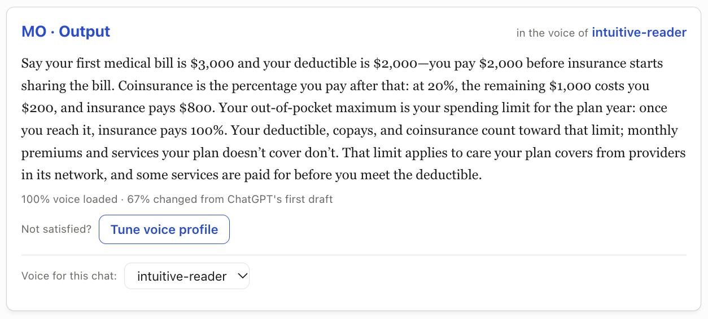

# Modus Operandi (MO)

**Long-term memory for AI.** Everything you read makes sense to you. Everything you write sounds like you.

## Why MO

AI explanations are generic: they don't know which analogies click for you or how deep to go. AI
writing drifts toward AI voice, and long pieces lose yours. Both come from the same problem: **what
you teach the model doesn't stick.**

**Before**


**After**



## Setup

Takes about two minutes in ChatGPT, on a plan with developer mode:

1. **Settings → Apps → Advanced → Developer mode**: turn it on.
2. **Add custom MCP server**: name `MO`, URL `https://modus-operandi-v1.fly.dev/mcp`, authentication **OAuth**.
3. **Connect**, then sign in with Google or Microsoft.
4. In a new chat, type `@MO help`.

## Using it

| You type in ChatGPT | MO window |
|---|---|
| `@MO` + anything | **Output** — ChatGPT's answer, reworked against this chat's voice |
| `@MO` · `@MO config` · `@MO profile` · `@MO seed` | **Config** — profiles, this chat's voice, seeds, tunes |
| `@MO tune` · or **Tune voice profile** under an output | **Tune** — pick A / B / C until it's right; ✓ saves it |
| `@MO trace` · `@MO debug` | **Trace** — what happened in this chat, and a link to your full trace |
| `@MO help` | **Help** |

- **A voice per chat:** each chat uses one profile, set only by you in an MO window.
- **Only the newest MO window in a chat is interactive**; older ones grey out.
- Without `@MO`, ChatGPT behaves normally.

## How it works

MO is an MCP server and in-chat app that stores writing you consider perfect (**seeds**) and your
preferences, captured through choices and notes (**tunes**). It makes ChatGPT work through them in order.

**ChatGPT produces content. MO keeps the books. You do all the evaluating.**

- **MO doesn't trust the model.** It runs no checks, interprets no text, and makes no AI calls. It
  stores your judgments verbatim, decides what ChatGPT sees and in what order, and refuses steps out
  of order.
- **You are the only judge.** Picks, notes, and seeds go from the MO window straight to MO, signed
  with a per-window key ChatGPT can't see. ChatGPT has no tool that records an evaluation.
- **Gaps are visible, never silent.** The window always shows the best version so far and how much of
  your voice has been applied ("72% voice loaded"); a partial result never looks finished.

```
 you ── "@MO explain X" ──► ChatGPT writes its normal answer ──► mo_output(initial)
                                                                     │
          MO hands out your store in fixed batches, one pass at a time:
          pass 1: seeds   →   pass 2: top tune   →   pass 3: next 3 tunes   → …
          each pass = INITIAL (what's said) + CURRENT (best so far) + this batch only
                                                                     │
 MO window ◄── best version so far, "x% voice loaded" ◄── ChatGPT submits each pass
     │
     └─ "Not satisfied? Tune" → A / B / C rounds → your ✓ seals a tune into the voice
```

- **Deterministic where MO acts:** ranking (seeds first, then tunes by rounds-to-✓), batch cut
  points (1, 3, 10, 30, …), pass order, and what's stored are fixed code. Same store → same batches.
- **Visible where ChatGPT acts:** whether it rewrote well is yours to judge; whether it skipped a
  pass, stalled, or never picked up a message shows in the window and the trace.

> **Status:** v1, hosted on Fly.io with sign-in, in daily personal use. Not yet listed in ChatGPT's app
> directory. Design: [docs/v1/DESIGN.md](docs/v1/DESIGN.md) · hosting: [docs/v1/HOSTING.md](docs/v1/HOSTING.md) ·
> what building it taught: [docs/v1/LESSONS.md](docs/v1/LESSONS.md).

## Observability

**[modus-operandi-v1.fly.dev/trace](https://modus-operandi-v1.fly.dev/trace)**: sign in with the same
account you use in ChatGPT. Or type `@MO trace` in a chat.

## Architecture

- **Python + MCP SDK**, one process on **Fly.io** with a persistent volume; data is plain JSON
  files, one folder per user (`data → users → profiles → seeds / tunes / runs`).
- **Sign-in:** OAuth 2.1 via **WorkOS AuthKit** through ChatGPT's *Connect* (dynamic client
  registration). Every tool call is scoped to the token's user; there is no default or shared
  folder to fall back on.
- **The MO window** (ChatGPT Apps SDK): its key arrives in hidden `_meta`, and its clicks go
  over HTTPS directly to MO, never through the model.
- **Trace sign-in:** WorkOS authorization code flow; MO sets its own signed, HTTP-only session cookie.

## Privacy

MO stores the minimum: your WorkOS user ID and what you put in. Seeds from other authors stay in
your profile and are never committed. **Today MO is a single-operator tool: admins can read all data
to debug it.** Account deletion, export, and a per-user storage cap are planned.

## Docs

- [v1 design](docs/v1/DESIGN.md) · [v1 hosting](docs/v1/HOSTING.md) · [v1 lessons](docs/v1/LESSONS.md)
- [v0 lessons](docs/v0/LESSONS.md): why the first prototype was thrown away
